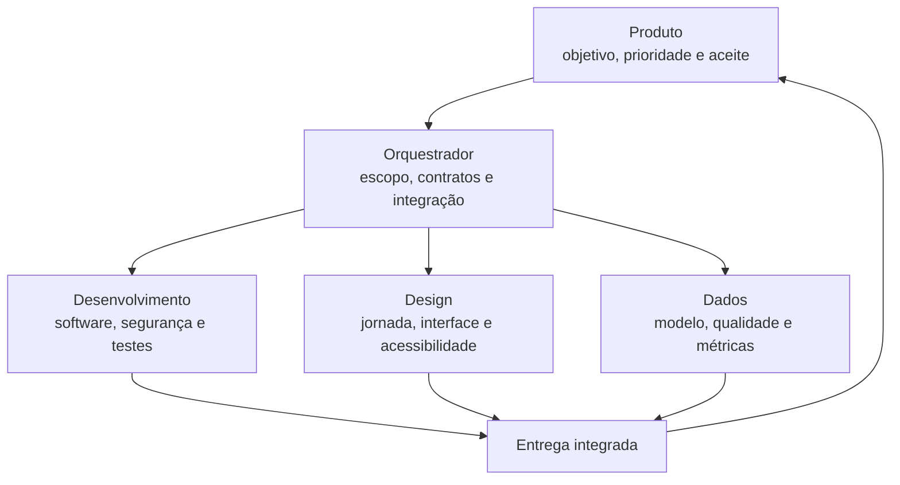

# Operação agêntica de Produto

Este modelo organiza uma pessoa de Produto, um agente orquestrador e especialistas em Desenvolvimento, Design e Dados.

## Responsabilidades

| Papel | Responsabilidade | Entregáveis mínimos |
|---|---|---|
| Produto | problema, prioridade, restrições e aceite | brief, critérios e decisões |
| Orquestrador | decomposição, roteamento, integração e riscos | plano, handoffs e validação final |
| Desenvolvimento | arquitetura, código, segurança e operação | código, testes, Eng Doc e rollback |
| Design | jornada, conteúdo, interação e acessibilidade | Design Doc, protótipo e especificação |
| Dados | fontes, modelo, qualidade, métricas e experimentos | Data Doc, contratos e reconciliação |

## Ciclo padrão

1. Enquadrar problema, público, resultado e critérios de aceite.
2. Mapear entradas, saídas, dependências, riscos e donos.
3. Delegar tarefas independentes com `.agents/HANDOFF.md`.
4. Executar dentro do escopo e registrar decisões relevantes.
5. Verificar cada área e testar os contratos entre elas.
6. Integrar uma única entrega revisável.
7. Medir adoção, sucesso e abandono.

## Roteamento por especialidade

- Desenvolvimento: código, infraestrutura, integrações, segurança ou desempenho.
- Design: jornada, conteúdo, layout, interação, responsividade ou acessibilidade.
- Dados: fontes, schemas, pipelines, qualidade, métricas, telemetria ou experimentos.
- Use mais de uma especialidade quando a feature possuir contratos entre áreas.
- O orquestrador executa tarefas pequenas e lineares quando delegar custaria mais contexto do que pouparia.

## Definição de pronto

- critérios de aceite demonstrados;
- estados vazio, carregando, erro e sucesso definidos;
- mobile e acessibilidade verificados;
- autorização, privacidade e exposição de dados revisadas;
- telemetria de adoção, sucesso e abandono especificada;
- testes proporcionais ao risco;
- Product, Design, Data e Eng Docs atualizados conforme o impacto;
- lançamento, validação em produção e rollback definidos.

## Aprovações e segredos

Agentes podem ler, analisar, editar localmente e testar. Devem solicitar aprovação no momento da ação para publicar, alterar produção, criar credenciais, mudar permissões, assumir custos, excluir dados ou enviar comunicações externas.

Segredos nunca entram em prompts, commits, logs ou handoffs. Use arquivos locais ignorados pelo Git ou o gerenciador de segredos do ambiente.

## Métricas da operação

- tempo entre brief e primeira entrega revisável;
- percentual aceito sem retrabalho;
- defeitos após integração;
- bloqueios por falta de contexto;
- tempo poupado por paralelismo;
- cobertura de documentação e telemetria.

Essas métricas avaliam o sistema de trabalho, não pessoas.

## Evolução para APOS

O [APOS v0.1](APOS-v0.1.md) oferece um primeiro ciclo executável baseado em intenção, contratos, decisões e evidências. O starter acima continua disponível; o APOS compõe capacidades conforme o problema e não exige um organograma fixo.
