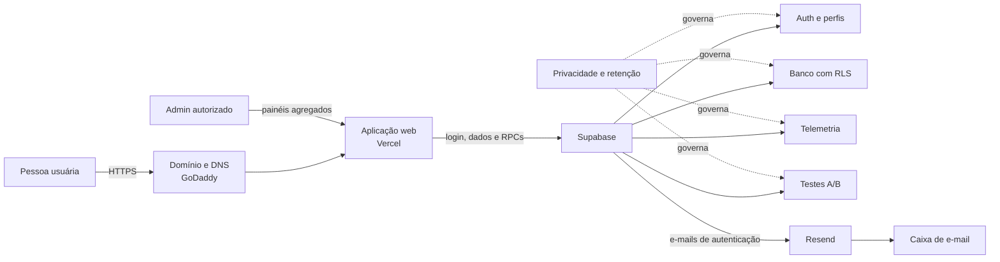

# Arquitetura básica

## Responsabilidade de cada serviço

| Camada | Responsabilidade | Não deve guardar |
|---|---|---|
| GoDaddy | domínio e registros DNS | chaves da aplicação |
| Vercel | frontend, HTTPS e publicação | `service_role` ou senha do banco |
| Supabase Auth | contas, sessões e recuperação | dados de pagamento |
| Supabase Database | dados do produto, papéis, telemetria e experimentos | senhas em texto aberto |
| Resend | entrega de e-mails transacionais | base completa de usuários |

O schema `public` contém somente APIs e tabelas protegidas por RLS. Funções operacionais ficam em `platform_private`, sem permissão direta para usuários do produto.

## Fluxos principais

1. O GitHub recebe uma alteração aprovada e a Vercel publica uma nova versão.
2. A pessoa abre o domínio; o DNS direciona a conexão HTTPS à Vercel.
3. O frontend usa somente a URL e a chave publicável do Supabase.
4. O Supabase autentica, aplica RLS e executa as funções de telemetria e experimentos.
5. O Resend entrega confirmação, recuperação de senha e comunicações transacionais autorizadas.
6. O painel administrativo consulta resultados agregados e exige papel `admin` no banco.

As migrações são cumulativas:

1. `0001_identity_and_roles.sql`: identidade e autorização;
2. `0002_product_telemetry.sql`: sessões e eventos;
3. `0003_ab_experiments.sql`: atribuição e resultados A/B;
4. `0004_retention.sql`: expurgo privilegiado.
