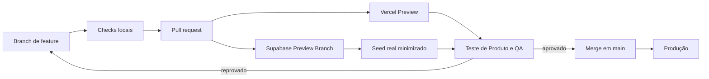

# Padrão de ambiente de teste

Registrar evidências de Padrão de ambiente de teste.

## Objetivo

Toda mudança relevante deve passar por um ambiente de homologação isolado, executando o mesmo código e as mesmas migrações que podem chegar à produção. O ambiente usa dados públicos reais ou uma cópia minimizada e desidentificada; nunca credenciais nem dados pessoais de produção.

## Fluxo obrigatório

## Regras

1. Produção recebe somente código revisado e aprovado na URL de Preview.
2. Migrações são aditivas e executadas primeiro na Preview Branch.
3. Preview usa URL, chave publicável, `service_role` e redirects próprios.
4. Seeds são reproduzíveis, versionados por fonte e sem dados pessoais.
5. Dados reais devem registrar fonte, versão, cobertura, rejeições e método de minimização.
6. Feature flags ficam desligadas em produção até o aceite explícito.
7. Falha de preview não pode causar fallback silencioso para o banco de produção.
8. A branch de banco é removida depois do merge ou abandono para interromper custos.

## Checklist de promoção

- [ ] build, lint, testes e verificação de segredos passaram;
- [ ] migrações foram aplicadas do zero;
- [ ] RLS e acesso entre contas foram testados;
- [ ] dados reais têm cobertura e linhagem documentadas;
- [ ] jornada desktop e mobile foi testada na URL pública de Preview;
- [ ] telemetria de descoberta, uso, sucesso, abandono e proteção apareceu no ambiente correto;
- [ ] desempenho e limites de provedor foram validados;
- [ ] rollback e limpeza do ambiente estão definidos;
- [ ] Produto registrou aprovação antes do merge.

## Custos

Antes de criar recursos cobrados, registre estimativa e obtenha confirmação no momento da ação. Preview Branches devem ter responsável, data de expiração e rotina de remoção.

## Vercel para repositórios privados de organização

O caminho recomendado para equipes é usar um plano Vercel que aceite repositórios privados pertencentes a uma organização GitHub (atualmente, Pro ou superior):

1. instale o GitHub App da Vercel na organização e limite-o aos repositórios necessários;
2. conecte o projeto Vercel ao repositório da organização, nunca à antiga localização pessoal;
3. mantenha `main` como Production Branch protegida;
4. habilite Preview Deployments para pull requests e comentários de status na PR;
5. cadastre as variáveis de Production somente no escopo Production;
6. cadastre URL e chave publicável do Supabase Preview no escopo Preview, preferencialmente restritas à branch da feature;
7. nunca cadastre `service_role`, senha de banco ou chave administrativa em variáveis `VITE_*`;
8. valide a URL de Preview antes do merge e remova variáveis/branches temporárias após a promoção.

Deploy manual por CLI é apenas uma contingência para homologação. Ele perde parte da rastreabilidade automática entre PR, commit, variáveis e Supabase Preview e não deve ser o processo contínuo da equipe.
