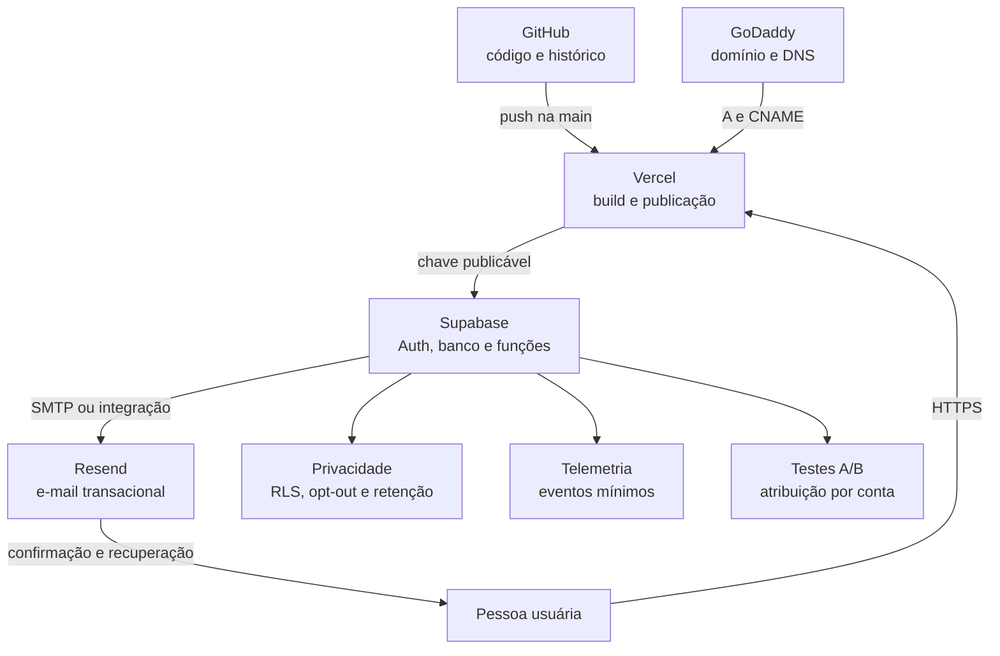

# Manual de configuração da plataforma

Orientar Manual de configuração da plataforma.

Este roteiro reproduz a fundação que usamos no Valora RJ. Ele separa o que deve ser feito uma vez por produto, o que muda entre ambientes e o que precisa ser validado antes da publicação.

> Nunca copie senhas, tokens, chaves privadas ou a chave `service_role` para documentos, GitHub ou variáveis iniciadas por `VITE_`.

## Visão geral

## Pré-requisitos

- uma organização e um repositório no GitHub;
- um projeto na Vercel conectado ao repositório;
- um projeto Supabase por ambiente;
- uma conta Resend;
- um domínio próprio com DNS sob controle;
- uma conta comum e uma conta administrativa para os testes finais.

## 1. Domínio no GoDaddy

1. No projeto da Vercel, abra **Settings > Domains** e adicione primeiro o domínio raiz e depois `www`.
2. Defina qual endereço será canônico. No Valora RJ usamos `https://www.valorarj.com.br`; o domínio sem `www` redireciona para ele.
3. A Vercel exibirá os registros necessários. Copie exatamente tipo, nome e valor apresentados ali.
4. Na GoDaddy, abra o domínio e entre em **DNS > Manage DNS**.
5. Edite ou crie o registro `A` do domínio raiz e o `CNAME` de `www` conforme a Vercel. Não mantenha registros conflitantes com o mesmo nome.
6. Preserve os registros de e-mail já existentes. Alterar nameservers pode remover a zona atual e exige recriar todos os registros.
7. Volte à Vercel e aguarde a situação **Valid Configuration**.
8. Teste domínio raiz, `www`, HTTPS e redirecionamento em janela anônima e no celular.

Não fixe IPs ou destinos deste manual em uma implantação nova: a Vercel pode apresentar valores diferentes conforme a conta e a configuração. Referências: [domínio personalizado na Vercel](https://vercel.com/docs/domains/working-with-domains/add-a-domain) e [registros DNS na GoDaddy](https://www.godaddy.com/en-uk/help/manage-dns-records-680).

## 2. Supabase

### Projeto e variáveis públicas

1. Crie um projeto separado para desenvolvimento, homologação e produção quando o produto entrar em operação contínua.
2. Em **Project Settings > API**, copie a URL do projeto e a chave publicável.
3. Cadastre na Vercel somente:
   - `VITE_SUPABASE_URL`;
   - `VITE_SUPABASE_PUBLISHABLE_KEY`.
4. Guarde `service_role`, senha do banco e tokens de administração apenas nos cofres do Supabase, da Vercel ou do CI, com acesso restrito.

### Banco e autorização

1. Aplique as migrações de `supabase/migrations` na ordem numérica em um ambiente não produtivo.
2. Confirme que todas as tabelas expostas têm RLS ativa.
3. Crie o primeiro papel administrativo por uma operação privilegiada. Nunca aceite `admin` vindo do cadastro ou de metadados editáveis pelo usuário.
4. Teste com duas contas comuns: uma conta não pode ler dados, eventos ou relatórios da outra.
5. Teste com a conta administrativa: ela acessa somente as consultas autorizadas para administração.

### Autenticação e URLs

1. Em **Authentication > URL Configuration**, defina a URL pública canônica como **Site URL**.
2. Adicione URLs de retorno exatas para produção e desenvolvimento. No Valora RJ:
   - `https://www.valorarj.com.br/**`;
   - `https://valorarj.com.br/**`;
   - `http://127.0.0.1:5173/**` para desenvolvimento.
3. Mantenha URLs de preview apenas quando necessárias e limite o padrão ao domínio da equipe.
4. Ative e teste e-mail/senha. Configure provedores sociais somente depois de cadastrar seus IDs e URLs de callback nos respectivos provedores.
5. Personalize separadamente os assuntos e textos de confirmação, convite, link mágico, troca de e-mail e recuperação de senha.
6. Teste cadastro, confirmação, login, logout, esqueci minha senha e redefinição em produção.

A **Site URL** define o retorno padrão de confirmações e recuperação. URLs passadas pela aplicação precisam constar na lista permitida. Referências: [URL Configuration](https://supabase.com/docs/guides/auth/redirect-urls) e [configuração geral do Auth](https://supabase.com/docs/guides/auth/general-configuration).

## 3. Resend

1. Use um subdomínio exclusivo para autenticação, como `auth.seudominio.com`. Isso separa a reputação do e-mail transacional de campanhas futuras.
2. Em **Resend > Domains**, adicione o subdomínio.
3. Copie para a GoDaddy todos os registros exibidos pelo Resend, incluindo SPF e DKIM. Adicione DMARC conforme a política do produto.
4. Volte ao Resend, solicite a verificação e aguarde o estado verificado.
5. Conecte o Resend ao projeto Supabase pela integração oficial ou configure o SMTP personalizado em **Authentication > SMTP Settings**.
6. Defina remetente coerente, por exemplo `Valora <conta@auth.valorarj.com.br>`.
7. Se funções de backend enviarem e-mails adicionais, armazene `RESEND_API_KEY` nos segredos da função. Nunca a coloque no frontend.
8. Envie testes para Gmail e outro provedor. Verifique caixa de entrada, spam, remetente, assunto, botão e URL de retorno.

O SMTP padrão do Supabase serve apenas para testes e tem limitações severas; produção deve usar um provedor próprio. Referências: [Resend com Supabase](https://resend.com/docs/knowledge-base/getting-started-with-resend-and-supabase), [SMTP personalizado no Supabase](https://supabase.com/docs/guides/auth/auth-smtp) e [verificação de domínio no Resend](https://resend.com/docs/dashboard/domains/introduction).

## 4. Vercel

1. Importe o repositório GitHub e confirme a organização correta.
2. Defina o diretório raiz, comando de build e pasta de saída conforme o framework.
3. Cadastre as variáveis públicas do Supabase para **Production**, **Preview** e **Development** somente quando cada ambiente tiver seu próprio backend.
4. Adicione o domínio e eleja o endereço canônico.
5. Para uma SPA, configure o fallback de rotas para que URLs como `/login`, `/reports` e `/admin` abram diretamente.
6. Configure cabeçalhos de segurança apropriados no arquivo de publicação.
7. Mantenha a publicação de produção ligada à branch protegida `main`. Pull requests usam previews sem segredos de produção.
8. Faça um smoke test após cada publicação: home, cadastro, autenticação, ação principal, relatório, logout e painel administrativo.

A integração GitHub da Vercel publica automaticamente alterações e gera previews para branches. Referência: [Vercel para GitHub](https://vercel.com/docs/git/vercel-for-github).

### Repositório privado de organização: configuração recomendada

Para um repositório privado pertencente a uma organização GitHub, use um plano Vercel que ofereça essa integração (Pro ou superior, conforme a oferta vigente). No GitHub, instale o GitHub App da Vercel na organização e conceda acesso somente aos repositórios necessários. Na Vercel, desconecte qualquer vínculo com a localização pessoal antiga, conecte o repositório da organização e confirme que cada PR recebe uma URL Preview.

Separe as variáveis por ambiente: Production aponta para o Supabase produtivo; Preview aponta para uma Preview Branch; Development aponta para o backend local ou de desenvolvimento. Proteja `main`, exija os checks do repositório e o aceite de Produto na URL Preview antes do merge. O deploy por CLI pode destravar uma homologação pontual, mas não substitui esse fluxo porque não mantém automaticamente a relação PR → commit → deploy → backend de Preview.

## 5. Módulo de privacidade

1. Registre para cada categoria de dado: finalidade, titular, fonte, base legal, operadores, retenção e destinatários.
2. Colete somente os campos necessários para a função do produto.
3. Ative RLS em toda tabela exposta e aplique menor privilégio.
4. Separe dados de negócio, telemetria e dados operacionais. Não envie conteúdo sensível em eventos.
5. Ofereça opt-out de analytics quando aplicável e valide a escolha no cliente e no banco.
6. Implemente um canal para acesso, correção, portabilidade, oposição e exclusão, conforme aplicável.
7. Defina um processo privilegiado de retenção e expurgo. Teste primeiro em homologação e mantenha logs do resultado.
8. Documente incidentes, responsáveis, fornecedores e procedimento de resposta.
9. Faça revisão jurídica antes de declarar conformidade com a LGPD. O kit oferece controles técnicos, não parecer jurídico.

## 6. Telemetria

1. Antes de desenvolver uma feature, escreva a pergunta de produto que os dados precisam responder.
2. Defina poucos eventos estruturados: descoberta, interação essencial, sucesso e, quando necessária, uma métrica de proteção.
3. Use nomes em `snake_case` e mantenha um catálogo no repositório do produto.
4. Grave eventos pelo RPC `record_product_event`. Ele valida autenticação, formato, sessão e opt-out no servidor.
5. Não registre texto digitado, endereço, e-mail, assinatura, relatório, senha, token ou dados de pagamento.
6. Leia resultados agregados pelo RPC administrativo. Diferencie pessoas únicas de cliques repetidos.
7. Revise eventos em homologação, monitore volume após o lançamento e inclua a tabela na rotina de retenção.

Uma feature só está pronta quando sua telemetria tem objetivo, eventos, responsável, privacidade e local de leitura definidos.

## 7. Testes A/B

1. Escreva a hipótese, a variante de controle, a mudança testada, a conversão principal e as métricas de proteção.
2. Crie o experimento como `draft`.
3. A aplicação pede a variante por `get_experiment_variant`. A atribuição é estável por conta, inclusive em aparelhos diferentes.
4. Implemente fallback para `control` quando o experimento não estiver ativo ou quando ocorrer falha.
5. Valide as duas variantes em homologação. Confirme que opt-out retorna controle sem criar atribuição.
6. Altere o estado para `running` e configure datas somente após aprovação de produto e privacidade.
7. Registre a conversão com `record_experiment_event`.
8. Analise conversão por usuário e não apenas quantidade de eventos. Considere duração, sazonalidade, tamanho da amostra e métricas de proteção.
9. Registre a decisão, marque como `completed` e remova do código a variante descartada.

O sistema não declara um vencedor automaticamente. A equipe de Produto continua responsável pela interpretação e pela decisão.

## Checklist de publicação

- [ ] domínio raiz e `www` respondem com HTTPS;
- [ ] o domínio canônico redireciona corretamente;
- [ ] Site URL e redirects do Supabase estão corretos;
- [ ] confirmação e recuperação chegam por Resend;
- [ ] nenhum segredo aparece no navegador ou no Git;
- [ ] conta comum não lê dados de outra conta;
- [ ] papel administrativo não pode ser concedido pelo frontend;
- [ ] opt-out impede telemetria e atribuição experimental;
- [ ] eventos aparecem no resumo administrativo;
- [ ] variante permanece estável para a mesma conta;
- [ ] rotina de retenção foi ensaiada fora de produção;
- [ ] backup e restauração foram testados;
- [ ] rollback da publicação está documentado.

## Registro do Valora RJ

| Item | Configuração adotada |
|---|---|
| Repositório do produto | `agendadoo-labs/price-wizard` |
| Domínio canônico | `https://www.valorarj.com.br` |
| Domínio raiz | redireciona para `www` |
| Supabase | projeto `konwvubojlsoiedsqoqr` |
| Hospedagem | Vercel conectada à branch `main` |
| E-mail transacional | Resend no subdomínio `auth.valorarj.com.br` |
| Remetente do produto | `Valora <conta@auth.valorarj.com.br>` |
| Desenvolvimento local | `http://127.0.0.1:5173` |

Este registro descreve endereços públicos e decisões. Credenciais reais permanecem nos cofres dos provedores.
