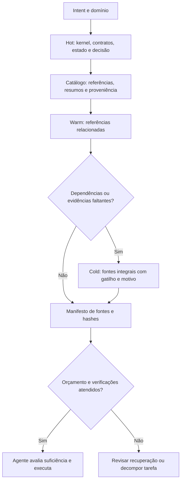

# Recuperação de informação e maturidade APOS

Data: 2026-10-01. Revisão bibliográfica dirigida, não revisão sistemática exaustiva. Fontes primárias: artigos e documentação oficial. Resultados publicados não foram reproduzidos neste projeto. Preprints de 2026 são sinais recentes, não consenso consolidado. A implementação abaixo é uma baseline verificável; não reivindica desempenho estado da arte.

## Conclusão e desenho

Continuar com Hot/Warm/Cold, separando temperatura, autoridade, sensibilidade e validade temporal. A literatura sustenta memória hierárquica e recuperação adaptativa; não estabelece três camadas como solução universal. Começar por fontes governantes completas e um catálogo lexical local, medir erros reais e só depois contratar embeddings/reranking. Preservar fontes integrais autorizadas; retenção está sujeita às políticas aplicáveis, inclusive exclusão de dados pessoais, e não ao orçamento de contexto.

A busca apenas sugere evidências. Uma decisão superseded permanece histórica mesmo quando recuperada por alta relevância. A seleção de fontes não certifica suficiência semântica. Contratos obrigatórios não podem ser sacrificados para caber em orçamento. Históricos relevantes podem entrar automaticamente em Warm; Cold requer trigger e reason, que o agente pode registrar sem nova aprovação humana para leitura já autorizada. Resumos são índices derivados, nunca substitutos exclusivos dos originais.

## Literatura e implicações

| Fonte primária | Contribuição examinada | Decisão para APOS e limite da transferência |
|---|---|---|
| Liu et al., 2023, [Lost in the Middle](https://arxiv.org/abs/2307.03172), TACL | Posição da evidência afeta uso de contexto nos modelos avaliados. | Evitar carregar tudo indiscriminadamente; reavaliar em modelos atuais, sem extrapolar percentuais antigos. |
| Packer et al., 2023/2024, [MemGPT](https://arxiv.org/abs/2310.08560) | Gerenciamento de memória hierárquica fora da janela de contexto. | Separar armazenamento de carregamento; Hot/Warm/Cold é nossa adaptação operacional. |
| Sarthi et al., 2024, [RAPTOR](https://arxiv.org/abs/2401.18059) | Recuperação em níveis de abstração usando árvore de resumos. | Resumos com ponteiros para originais; não implementar árvore vetorial sem benchmark que justifique custo e risco de resumo. |
| Asai et al., 2023, [Self-RAG](https://arxiv.org/abs/2310.11511) | Recuperação adaptativa e crítica da geração. | Gate de necessidade/suficiência; nosso roteador não reproduz treinamento nem reflection tokens do artigo. |
| Yan et al., 2024, [CRAG](https://arxiv.org/abs/2401.15884) | Avaliação da qualidade da recuperação e ações corretivas. | Falta de evidência produz revisão, nunca conclusão automática de inexistência. Não há confiança calibrada no piloto. |
| Edge et al., 2024/2025, [GraphRAG](https://arxiv.org/abs/2404.16130) | Síntese global com grafos e comunidades. | Usar relações APOS explícitas primeiro; grafo extraído por LLM fica para perguntas transversais comprovadamente difíceis. |
| Anthropic, 2024, [Contextual Retrieval](https://www.anthropic.com/engineering/contextual-retrieval) | Contextualização de fragmentos, busca lexical/densa e reranking. | Conservar domínio, título e proveniência. Nosso piloto usa metadados lexicais, não implementa o pipeline completo e não herda seus ganhos publicados. |
| Wu et al., 2024, [LongMemEval](https://arxiv.org/abs/2410.10813) | Extração, raciocínio entre sessões/temporal, atualização e abstenção. | Criar avaliações de substituição, período, evidência ausente e recuperação histórica. Benchmark de chat não prova segurança operacional. |
| [MemoryAgentBench](https://arxiv.org/abs/2507.05257), 2025 | Avaliação incremental de memória de agentes. | Testar atualização e interferência ao longo de sessões, além de perguntas isoladas. |
| Wu et al., 2026, [LongMemEval-V2](https://arxiv.org/abs/2605.12493), preprint | Estado dinâmico, workflows e conhecimento de ambiente. | Avaliar retomada e armadilhas operacionais; ainda não executado no APOS. |
| Yuan et al., 2026, [AgentIR](https://arxiv.org/abs/2605.25092), preprint | Cascata adaptada à carga de memória conversacional. | Sustenta testar uma baseline barata antes de recuperação densa; nenhuma alegação de equivalência de desempenho. |

## Implementação entregue e limites

`scripts/apos-layered-memory.mjs` é um módulo sem rede, dependências externas ou geração de resumos. O compilador existente o usa via `layered_memory.catalog`. O catálogo contém metadados revisados, paths e hashes; pode cobrir um subconjunto explicitamente declarado do acervo. Indexação completa, permissões empresariais e armazenamento remoto não são alegados.

Hot de domínio entra sempre; Warm entra por correspondência lexical ou dependência explícita; Cold entra por relevância mais trigger justificado. Fontes selecionadas permanecem integrais. O manifesto registra fontes selecionadas, adiadas, motivos, hashes, validade declarada e fingerprint determinístico. Fonte obrigatória ausente, índice defasado ou consulta sem correspondência geram `retrieval_incomplete`; excesso de orçamento gera `budget_exceeded`, sem cortar fontes. `bytes/4` é uma heurística de tamanho e não um limite superior garantido de tokens.

Compatibilidade: a recuperação obrigatória do compilador anterior continua presente. Isso evita remover contratos por engano, mas não comprova redução total de tokens. `include_historical=true` continua como escape legado e pode carregar material amplo. Para novos Intents, preferir query, required_source_ids, trigger e reason. O catálogo não é um banco de vetores, nem um mecanismo de autorização; somente metadados internos sanitizados entram neste piloto.

## Comparativos de modelos e maturidade

| Modelo/fonte | Semelhança útil | Avaliação para APOS |
|---|---|---|
| [GitHub Spec Kit](https://github.com/github/spec-kit) | Constituição, especificação, plano, tarefas, implementação e convergência; processos de bugs e avaliação de ideias. | APOS compartilha intenção e contratos; precisa tornar instalação e caminho inicial tão verificáveis quanto seus próprios gates. |
| [OpenSpec](https://github.com/Fission-AI/OpenSpec) | Especificação vigente separada de propostas e mudanças arquivadas; colaboração entre repositórios. | Muito próximo da separação estado/histórico. APOS deve manter ponteiros de supersessão e testar consistência entre repositórios. |
| [BMAD Method](https://github.com/bmad-code-org/BMAD-METHOD) | Processo proporcional, decisões explícitas e contexto durável ao longo da entrega. | APOS pode preservar composição por capacidades sem impor papéis fixos. Falta medir se a cerimônia reduz retrabalho frente a uma baseline. |
| [LangGraph persistence](https://docs.langchain.com/oss/python/langgraph/persistence) | Checkpoints por execução e memória durável entre execuções. | Complementar: APOS governa contratos; um runtime durável executaria retomadas. Documentação em Git não substitui fila nem checkpoint operacional. |
| [MemGPT](https://arxiv.org/abs/2310.08560) | Movimentação entre níveis de memória. | Referência de arquitetura de memória; não é substituto do modelo de governança de produto. |

Escala interna, não certificação: definido → executável → validado em uso representativo → medido continuamente. Não atribuir nota global numérica sem pesos e amostra.

| Dimensão APOS | Evidência local | Maturidade / lacuna |
|---|---|---|
| Governança, escopo, contratos | AGENTS, profiles, verificadores | Executável parcialmente; alguns gates conferem estrutura/texto e não o resultado operacional. |
| Memória e retomada | Bootstrap, projeções, compilador, novos testes | Executável localmente; falta avaliação de recuperação em tarefas reais e corpus completo. |
| Idempotência do runtime experimental | `packages/apos/apos/core.py`: transação SQLite, chave+digest, revisão esperada; testes de replay e falha atômica | Validada para catálogo local delimitado. Não extrapolar para emails, pagamentos, deploy ou agentes distribuídos. |
| Operação Valora | Registros e testes específicos de privacidade, dados e releases | Experiência de consumidor real, mas evidências são de cada domínio e não certificam o kit inteiro. |
| Economia de tokens | Estimativas de contexto e campos de custo | Instrumentação parcial; nenhum ganho percentual demonstrado nesta revisão. |
| Vários times e adoção externa | Workstreams e starter | Definido/prototipado; faltam exercícios concorrentes e onboarding independente. |
| Recuperação de desastre | Manifestos e plano anteriores | Planejado; restauração ponta a ponta não comprovada por esta revisão. |

Diagnóstico: APOS é um framework experimental utilizável, com governança e ferramentas locais relevantes; ainda não uma plataforma empresarial de organizações agênticas validada em escala. Corrige-se a avaliação anterior de idempotência: já existe mecanismo transacional concreto no runtime de catálogo, embora não governe automaticamente todo o trabalho diário dos agentes.

## Observação local da implantação

Na primeira compilação dos Intents desta revisão, a heurística bytes/4 estimou 38.174 tokens no kit e 55.511 no Valora. Ambos ultrapassaram o baseline de 30.000 e falharam sem truncamento. Esses valores descrevem fontes selecionadas, não consumo faturado. O envelope temporário de 60.000, já usado na migração documental, é registrado somente para esta revisão; não aumenta o padrão global. Alterações posteriores de documentação e estado podem mudar as estimativas finais.

O resultado revela acoplamento excessivo na seleção governante anterior. A baseline preservada não deve ser chamada de Hot compacto até que separemos, com testes de cobertura, contratos mandatórios de documentação auxiliar. A economia global permanece não comprovada. Esta limitação é parte do resultado, não evidência de que embeddings resolveriam o problema.

## Evolução priorizada

1. Corpus de perguntas reais com fontes esperadas, incluindo decisões antigas críticas, conflitos, respostas inexistentes e estados temporais. Separar treino/ajuste de teste reservado.
2. Medir recall de fontes necessárias, precisão de autoridade vigente, abstenção, violações de acesso, p50/p95, bytes/tokens e retrabalho. Critérios de segurança: zero omissão silenciosa de contrato e zero promoção de fonte histórica a autoridade atual.
3. Comparar baseline atual, catálogo lexical e BM25; depois embeddings + fusão + reranking, com mesmo corpus, modelo leitor e orçamento. Escolher metas de qualidade/custo após observar a baseline.
4. Só ativar índice semântico se resolver falhas verificadas de vocabulário/sinonímia; validar frescor, exclusões e permissões antes de uso multiusuário.
5. Só ativar grafo/sumarização hierárquica se perguntas entre domínios justificarem custo de construção e atualização. Resumos precisam de proveniência e caminho para original.
6. Exercitar concorrência e replay com falhas entre serviços; integrar runtime durável quando houver workflow material que precise disso. Não equiparar um teste lexical ou de schema a confiabilidade empresarial.
