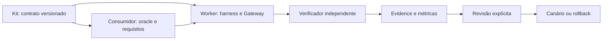

# Engenharia e otimização de LLMs

Explicar Engenharia e otimização de LLMs.

O domínio `llm_engineering` reúne harness, prompts, contexto, recuperação, memória, ferramentas, avaliações, custo e latência. É uma fronteira de conhecimento e responsabilidade; não exige um agente ou time dedicado.

## Contrato entre projetos

| Projeto | Responsabilidade |
|---|---|
| product-platform-kit | Contrato reutilizável, política e template neutros |
| Personal Worker | Gateway, quotas, ledger, execução e harness compartilhados |
| Produto consumidor | Dados, semântica, oracle e critérios de aceitação do negócio |

O produto referencia uma revisão do contrato; o Worker implementa os mecanismos compartilhados. Adotar uma nova revisão requer comparação de contratos, testes e atualização explícita do vínculo. Nenhum repositório recebe autoridade sobre dados ou orçamento de outro apenas por dependência.

## Ciclo de trabalho

1. Abrir Intent e experimento com hipótese e uma variável de mudança.
2. Fixar hashes de modelo, prompt, contexto, ferramentas, corpus, verificador, política e ambiente.
3. Declarar metas de qualidade, amostra, tempo, chamadas, tokens e custo antes da execução. Campos não preenchidos bloqueiam promoção.
4. Desenvolver em conjunto separado; manter oracle e holdout fora do contexto e memória do modelo.
5. Comparar baseline e candidato com os mesmos casos e orçamento. Medir acerto semântico, falhas críticas, pass@1, latência, tentativas e custo por resultado verificado.
6. Preservar erros, truncamentos, indisponibilidade e métricas desconhecidas. Dados de uso ausentes não são zero.
7. Revisor explícito decide a promoção com evidência vigente e revisão de rollback. Holdout usado para ajustes passa a regressão conhecida.

## Segurança e autoridade

A otimização não pode remover contratos para reduzir tokens, relaxar privacidade, ativar provider/modelo, ampliar quota nem aceitar autoavaliação do executor. Cache precisa respeitar revisão dos dados e isolamento; memória deve manter proveniência e revisão, sem incorporar respostas do holdout. Medir latência melhor não compensa regressão crítica.

A política é um contrato de governança, não um novo mecanismo de enforcement. Esta entrega não executa inferência nem comprova melhoria de modelo. Limites e quotas existentes continuam responsáveis por admissão e interrupção.

## Artefatos

- `.apos/domains/llm-engineering.json`: responsabilidade e fronteiras.
- `.apos/llm/evaluation-policy.json`: critérios e métricas obrigatórios.
- `.apos/llm/experiment-template.json`: experimento inicialmente não elegível.
- `.apos/context/context-profile.json` e `.apos/epistemic/registry.json`: recuperação e validade do conhecimento.

## Adoção reutilizável

O pacote opcional está em `templates/llm-engineering/`. Copie os três arquivos JSON para `.apos/`, registre o domínio no perfil de contexto e registro epistêmico, e defina owner, dependências, metas e orçamento locais. O starter APOS e as versões publicadas continuam inalterados. O template não fixa fornecedor, modelo, eleição, tamanho de amostra ou meta universal.
