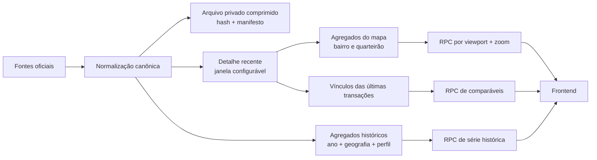

# Arquitetura de dados para mapas de mercado

Explicar Arquitetura de dados para mapas de mercado.

## Objetivo

Responder navegação, resumos e comparáveis sem enviar a base canônica ao navegador nem recalcular medianas em cada movimento do mapa. O padrão separa serving, histórico e restauração.

## Três temperaturas

### Detalhe quente

Mantém a janela necessária para listar transações individuais. O padrão inicial é o ano corrente e os dois anteriores. Cada produto pode aumentar essa janela com `MapRetentionPolicy`, desde que meça custo e latência.

### Histórico agregado

Períodos anteriores armazenam somente métricas reconstruíveis por ano, nível geográfico, tipologia e faixa de área:

- quantidade de transações;
- mediana do valor total;
- mediana, primeiro e terceiro quartis de preço por m²;
- quantidade e participação financiada;
- mediana do percentual financiado;
- primeira e última data cobertas.

Não derive média a partir de medianas. Quando níveis menores forem combinados, consulte um agregado já calculado para o nível superior.

### Arquivo privado

Preserve o canônico completo fora do Git, do bundle e do banco de serving. Use arquivos comprimidos, criptografia do provedor, controle de acesso, versionamento, manifesto de origem e SHA-256. Teste restauração periodicamente. Remoção do detalhe online exige conferência dos agregados, cópia íntegra e autorização explícita.

## Modelo de serving

- `market_areas`: um registro por bairro ou quarteirão, com centroide, período, amostra e medianas prontas;
- `transaction_memberships`: somente os vínculos necessários para abrir comparáveis recentes;
- `transactions_recent`: detalhe da janela quente;
- `market_yearly`: histórico estreito, sem identificadores desnecessários;
- RPCs autenticadas: única superfície de leitura do produto.

O frontend recebe no máximo os campos exibidos. Cadastro fiscal, matrícula, hashes e informações de origem permanecem na camada restrita.

## Nível de detalhe

- zoom distante: nenhuma transação individual;
- zoom intermediário: áreas de bairro/localidade;
- zoom próximo: pontos minimalistas de quarteirão;
- seleção: resumo de mercado;
- ação explícita: lista limitada de comparáveis.

Quarteirão só existe quando a correspondência de CEP, rua e número é auditável. Ausência de ponto não invalida a transação.

## Atualização

1. carregue novo lote canônico idempotente;
2. valide cidade, datas, valores, área, hashes e rejeições;
3. atualize agregados e vínculos em staging;
4. compare contagens e amostras com a versão anterior;
5. troque a versão ativa atomicamente;
6. invalide caches pela versão do dataset;
7. arquive o canônico e só então aplique retenção.

## Segurança e privacidade

Tabelas físicas não são expostas a `anon` ou `authenticated`. RPCs aplicam conta ativa, limites de parâmetros, rate limit e paginação. Telemetria registra cidade, nível, zoom, latência e contagem — nunca endereço livre, coordenada precisa de pessoa ou identificador fiscal.
